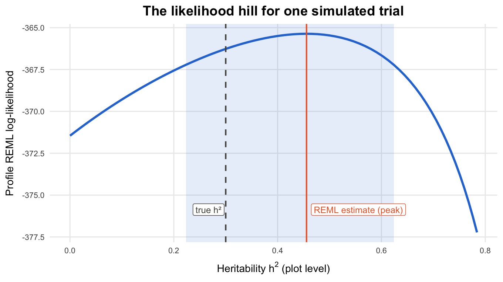
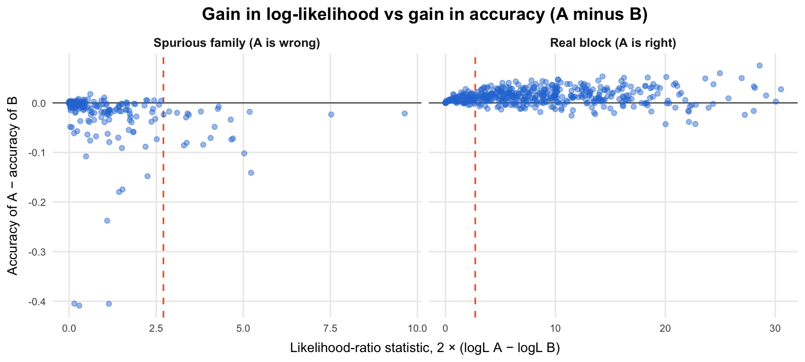
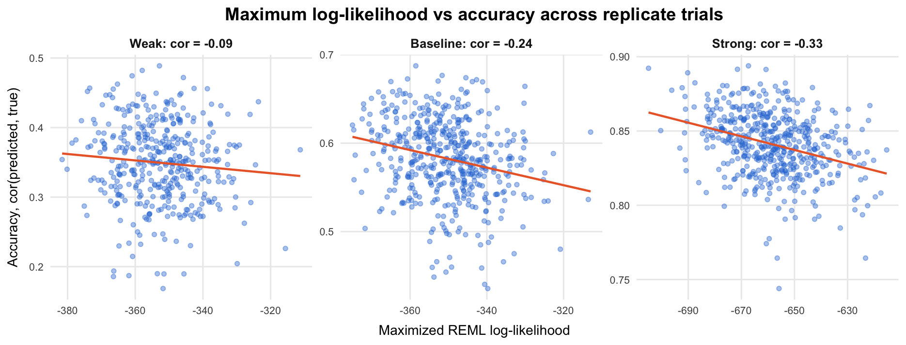
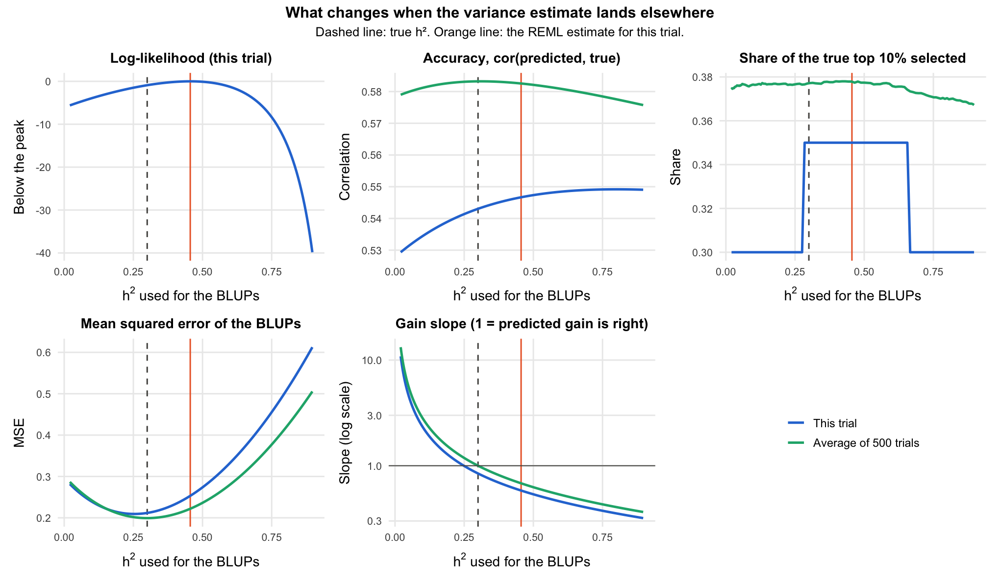
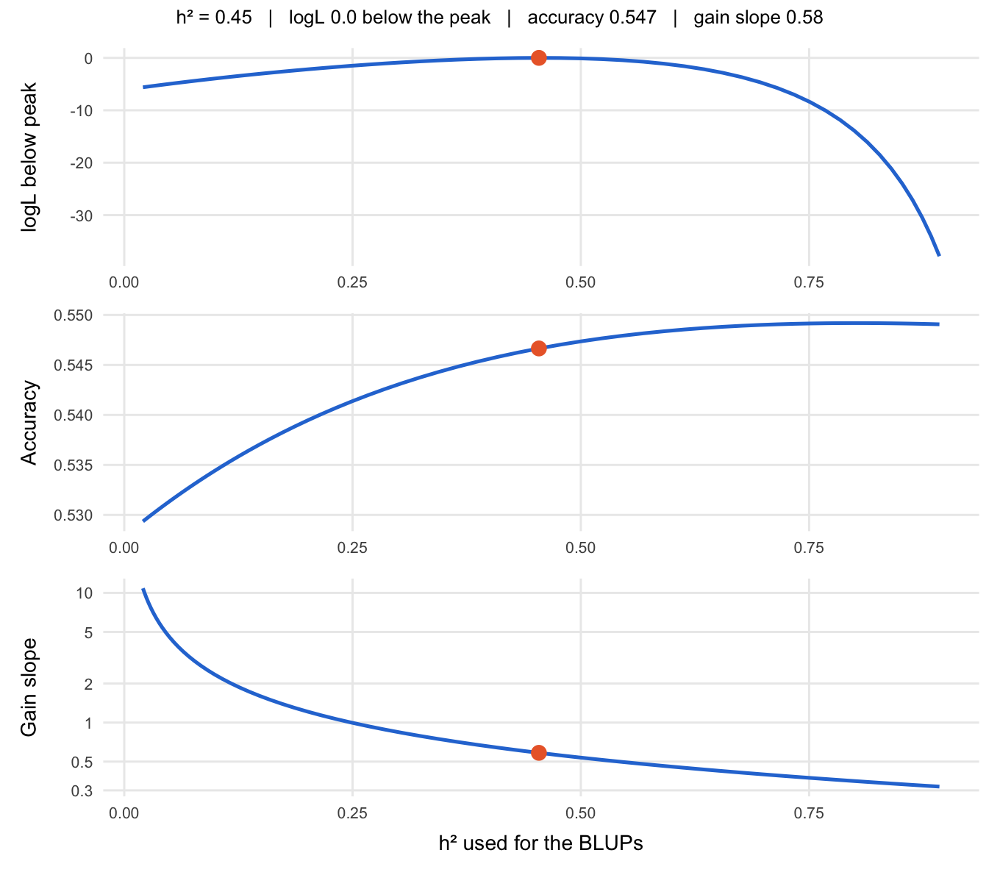
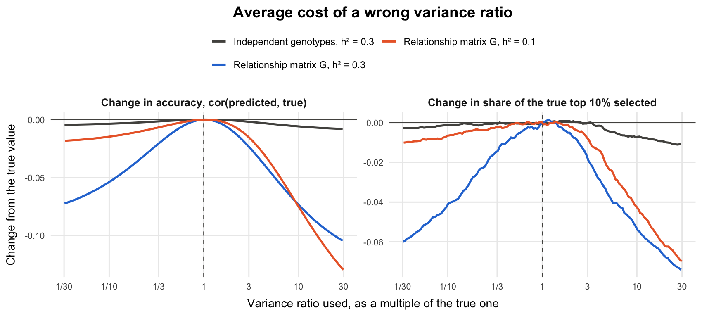
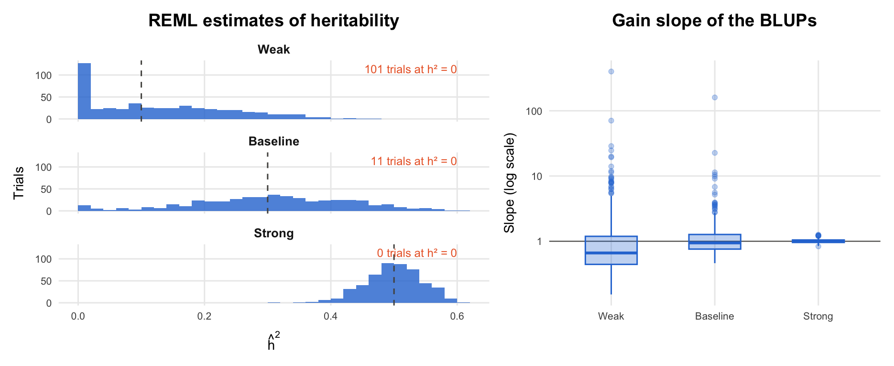
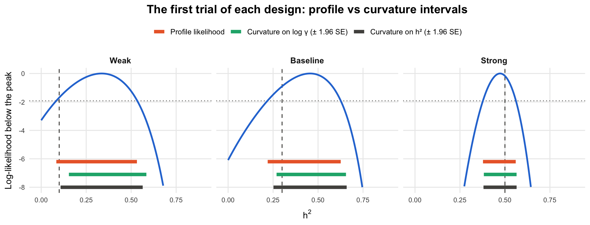
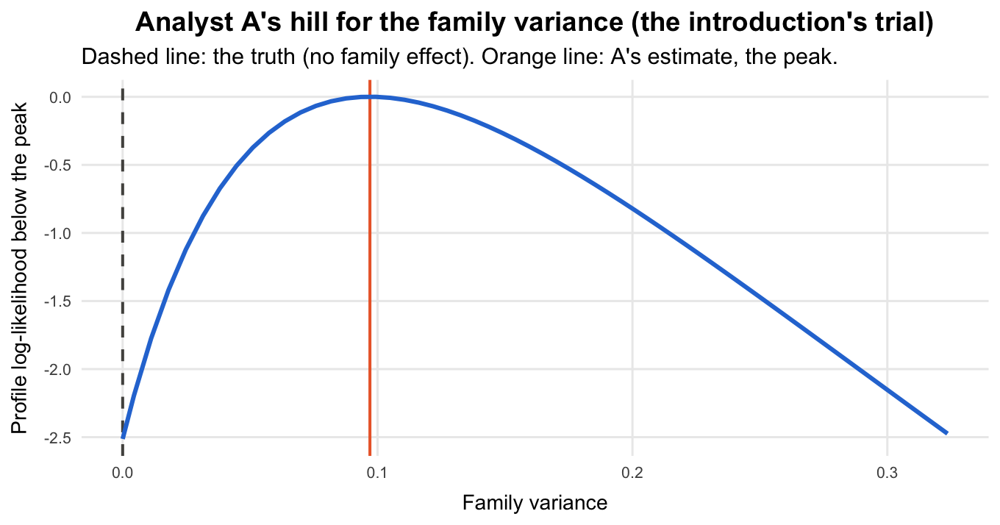

## Introduction: The Higher-Likelihood Trap

Two analysts receive the same field trial: 200 genotypes, 40 of them planted in two plots and the other 160 in a single plot (240 plots in total, a partially replicated design). The genotypes come from 20 families of 10 genotypes each. Both analysts fit a linear mixed model with a random genotype effect, estimate the variance components by REML, and rank the genotypes by their predicted genetic values (BLUPs). The top 20 genotypes (the top 10%) will be advanced.

- **Analyst B** fits genotype only.
- **Analyst A** adds a random family effect. Their REML log-likelihood goes up, from -352.61 to -350.10, and the formal likelihood-ratio test agrees: statistic 5.03, p = 0.012 against the standard boundary-corrected reference ($\tfrac12\chi^2_0 + \tfrac12\chi^2_1$, a large-sample approximation). The family variance is estimated at 0.097.

Analyst A predicts each genotype as its own effect plus its family's effect, so the two analysts advance different lists. Whose list would you trust? Most of us would pick Analyst A: the model "fits better", and the test says the family effect is real.

This article is about why that instinct can be wrong. A higher REML log-likelihood means that the variance parameters explain the *observed* data better under the assumed model. It does not guarantee more accurate predictions of the genetic values we select on. Accuracy depends on which terms the model contains and where their variance estimates land (an extra term whose variance is estimated above zero changes every prediction), not on the height of the likelihood. The numbers we report from a trial, such as heritability and predicted gain, also depend on how well the data pin those estimates down.

There is a second, related habit. Anyone who has fitted mixed models in ASReml has seen this message:

```
Warning: Log-likelihood not converged
```

The usual response is to run `update()` until the warning goes away, or to ignore it because the BLUPs barely change. We will come back to this warning later and see what it does and does not put at risk.

To answer these questions honestly we need to know the truth, so everything here is **simulated**: the true genetic value of every genotype is known, and accuracy is measured directly as the correlation between predicted and true genetic values, plus the share of the true top 10% that each analyst selects. All models are fitted with a short REML/BLUP "oracle" in base R with dense linear algebra, shown in full; no commercial or specialized mixed-model software produces any result. Each experiment is repeated over 500 simulated trials with fixed seeds, so we report how often a pattern holds, not one lucky example.

> **The four myths at a glance**
>
> 1. **"A higher log-likelihood means better predictions."** Not necessarily. A random term that does not exist still raised the log-likelihood in 44.2% of our simulated trials, and when it did, the predictions were usually less accurate (77.4% of those trials). Across trials or datasets, log-likelihoods are not comparable at all.
> 2. **"The estimate is all that matters."** A variance estimate in the wrong place changes what you *report* (heritability, predicted gain, reliability) far more than which lines you *select*, as long as the genotypes are unrelated and similarly replicated. With a genomic relationship matrix, or with very uneven replication, the rankings move too.
> 3. **"All trials are equally trustworthy."** No. Weak trials give flat hills: scattered variance estimates and boundary fits with zero genetic variance. Intervals built from standard errors change with the scale they are built on, do not exist for boundary fits, and in weak trials usually reach below zero on the heritability scale. Profile-likelihood intervals have none of these problems and show honestly how little such a trial knows.
> 4. **"'Not converged' is just a warning."** It is a warning about every number that should come from the top of the hill (the log-likelihood, likelihood-ratio tests, variance components, heritability), even when the rankings of a simple genotype model barely change.
>
> **So how do you choose between models?** Cross-validation over held-out plots and the boundary-corrected likelihood-ratio test detect whether an extra term is real; neither tells you which model will predict better on the trial in front of you. The [practical checklist](#practical-checklist) at the end turns all of this into a short list of rules.

## The likelihood hill

Most of what follows can be read off one picture. For a model with a genotype effect and a residual, the REML log-likelihood depends on the variance components only through their ratio, which we can express as a heritability, $h^2 = \sigma^2_g / (\sigma^2_g + \sigma^2_e)$, once the residual variance is set to its best value for each $h^2$. Plotting that *profile* log-likelihood against $h^2$ gives a hill. Here $h^2$ is broad-sense heritability on a plot basis (what many breeders write as $H^2$); programs usually report heritability on an entry-mean basis, which is higher whenever entries have several plots (Cullis, Smith and Coombes 2006; Piepho and Möhring 2007).



This is one simulated trial of the baseline design (50 genotypes with two plots, 150 with one; true $h^2$ = 0.3). Three features of the hill matter, and only two of them are about the variance estimate:

- **Where the peak sits.** The REML estimate is the top of the hill, here $\hat h^2$ = 0.456. It is not the true value (0.3): it is the value that best explains *this* dataset, noise included.
- **How wide the hill is.** The shaded band holds the values of $h^2$ whose log-likelihood is within 1.92 units of the peak, roughly a 95% profile-likelihood interval: from 0.22 to 0.62. A flat, wide hill means the data cannot tell those values apart.
- **How high the peak is.** The peak value, -365.4, is a property of this dataset. On its own it says nothing about how good the predictions are.

> **In plain words:** the REML log-likelihood tells you which variance components best explain the data you have. Its peak is your estimate and its width is your uncertainty. Its height is not a score for prediction quality, and in the rest of the article we will keep asking what the height can and cannot tell us.

## Building the oracle

We use the standard model for a single trial:

$$
y = X\beta + Zg + e, \qquad g \sim N(0, \sigma^2_g I), \qquad e \sim N(0, \sigma^2_e I),
$$

where $y$ holds the plot values, $X\beta$ is the fixed part (here just an overall mean), $Z$ assigns plots to genotypes, $g$ are the genetic values we want to predict, and $e$ is the plot error. In the simulations $\sigma^2_g + \sigma^2_e = 1$, so $\sigma^2_g$ is the plot-level (broad-sense) heritability.

REML ("restricted" or "residual" maximum likelihood; Patterson and Thompson 1971; Harville 1977) estimates $\sigma^2_g$ and $\sigma^2_e$ from the part of the data that is free of the fixed effects: think of it as first removing the overall mean, then asking which variance components make the remaining contrasts between plots most probable. The BLUPs then come from Henderson's mixed model equations (Henderson 1975). Computed with estimated variance components instead of the true ones, as they always are in practice, they are strictly *empirical* BLUPs; we call them BLUPs for short.

**Under the hood: how REML works (the formulas)**

For variance components $\theta = (\sigma^2_g, \sigma^2_e)$, with $V = \sigma^2_g ZZ' + \sigma^2_e I$ and $p$ fixed-effect parameters among $n$ plots, the REML log-likelihood is

$$
\ell_R(\theta) = -\tfrac12\left[(n-p)\log 2\pi + \log|V| + \log|X'V^{-1}X| + y'Py\right], \quad P = V^{-1} - V^{-1}X(X'V^{-1}X)^{-1}X'V^{-1}.
$$

Written as the likelihood of $n-p$ orthonormal error contrasts $K'y$ (with $K'X = 0$), it differs from $\ell_R$ only by the constant $\tfrac12\log|X'X|$, which does not depend on $\theta$. Different programs report different constants, which is one more reason not to compare log-likelihood values across programs.

With $\gamma = \sigma^2_g/\sigma^2_e$, one eigendecomposition $K'ZZ'K = UDU'$ and $w = U'K'y$ give the whole hill cheaply. The residual variance has a closed form for each $\gamma$, and the profile log-likelihood is

$$
\hat\sigma^2_e(\gamma) = \frac{1}{n-p}\sum_j \frac{w_j^2}{1+\gamma d_j}, \qquad \ell(\gamma) = -\tfrac12\left[(n-p)(\log 2\pi + 1) + (n-p)\log\hat\sigma^2_e(\gamma) + \sum_j \log(1+\gamma d_j)\right].
$$

The BLUPs solve the mixed model equations with $\lambda = 1/\gamma$:

$$
\begin{bmatrix} X'X & X'Z \\ Z'X & Z'Z + \lambda I \end{bmatrix} \begin{bmatrix} \hat\beta \\ \hat g \end{bmatrix} = \begin{bmatrix} X'y \\ Z'y \end{bmatrix}.
$$

> **In plain words:** after removing the mean, the data are rotated so that each piece is independent; the log-likelihood then becomes a simple sum that is cheap to evaluate for any heritability. The REML estimate is the heritability where that sum is highest. The BLUP of a genotype shrinks its observed deviation from the mean towards zero, and genotypes with fewer plots are shrunk more.

The whole oracle fits on one screen, and we checked it against a naive computation before trusting it.

**Under the hood: the oracle code and how we checked it**

`reml_fit()` searches a fine grid of 401 values of $\log\gamma$ (plus $\gamma = 0$, the boundary where $\hat\sigma^2_g = 0$), then refines the best grid point with `optimize()`, so we can be confident we have the global maximum of the hill and not just a local bump:

```r
# Dense REML oracle and BLUP for one random genetic effect.
#
# Model:  y = X beta + Z g + e,   g ~ N(0, sigma2_g G),   e ~ N(0, sigma2_e I)
# gamma = sigma2_g / sigma2_e (signal-to-noise), lambda = 1 / gamma.
# G = NULL means G = I (independent genotypes).

# One-time preparation for a dataset: everything that does not depend on gamma.
reml_setup <- function(y, X, Z, G = NULL) {
  n <- length(y)
  p <- ncol(X)
  qx <- qr(X)
  stopifnot(qx$rank == p)
  # K: orthonormal contrasts free of the fixed effects (K'X = 0, K'K = I).
  K <- qr.Q(qx, complete = TRUE)[, -seq_len(p), drop = FALSE]
  ZGZ <- if (is.null(G)) tcrossprod(Z) else Z %*% G %*% t(Z)
  # Eigen-decomposition K'ZGZ'K = U D U'.
  eig <- eigen(crossprod(K, ZGZ %*% K), symmetric = TRUE)
  d <- pmax(eig$values, 0)
  w <- drop(crossprod(eig$vectors, crossprod(K, y)))
  list(d = d, w = w, n = n, p = p, y = y, X = X, Z = Z, G = G)
}

# REML estimate of sigma2_e for a given gamma (vectorized over gamma).
reml_sigma2_e <- function(gamma, setup) {
  vapply(gamma, function(g) {
    sum(setup$w^2 / (1 + g * setup$d)) / (setup$n - setup$p)
  }, numeric(1))
}

# Profiled REML log-likelihood as a function of gamma (vectorized over gamma).
reml_loglik <- function(gamma, setup) {
  nu <- setup$n - setup$p                        # residual degrees of freedom
  s2e <- reml_sigma2_e(gamma, setup)             # best sigma2_e for each gamma
  logdet <- vapply(gamma, function(g) sum(log1p(g * setup$d)), numeric(1))
  -0.5 * (nu * (log(2 * pi) + 1) + nu * log(s2e) + logdet)
}

# Find the REML estimate: grid search on log(gamma) plus gamma = 0,
# then optimize() between the neighbours of the best grid point.
reml_fit <- function(setup, log_gamma_grid = SETTINGS$log_gamma_grid) {
  ll_fun <- function(lg) reml_loglik(exp(lg), setup)
  grid_ll <- ll_fun(log_gamma_grid)
  best <- which.max(grid_ll)
  bracket <- log_gamma_grid[c(max(best - 1, 1), min(best + 1, length(log_gamma_grid)))]
  opt <- optimize(ll_fun, bracket, maximum = TRUE, tol = 1e-10)

  # Keep the better of the grid point and the optimizer.
  if (opt$objective >= grid_ll[best]) {
    log_gamma <- opt$maximum
    loglik <- opt$objective
  } else {
    log_gamma <- log_gamma_grid[best]
    loglik <- grid_ll[best]
  }
  gamma <- exp(log_gamma)

  # Boundary: no genetic variance (gamma = 0) beats every interior point.
  ll_zero <- reml_loglik(0, setup)
  boundary <- ll_zero > loglik
  if (boundary) {
    gamma <- 0
    loglik <- ll_zero
  }

  # Curvature in log(gamma): how sharply the data pin gamma down.
  h <- 1e-3
  info <- if (boundary) NA_real_ else
    -(ll_fun(log_gamma + h) - 2 * loglik + ll_fun(log_gamma - h)) / h^2

  sigma2_e <- reml_sigma2_e(gamma, setup)
  list(gamma = gamma, sigma2_g = gamma * sigma2_e, sigma2_e = sigma2_e,
       h2 = gamma / (1 + gamma), loglik = loglik, boundary = boundary,
       info_log_gamma = info,
       grid = data.frame(log_gamma = log_gamma_grid, loglik = grid_ll))
}

# Reference implementation: the same REML log-likelihood from the full n x n
# matrix V (Harville form R1, plus 0.5 log|X'X| to match the contrast form).
reml_loglik_naive <- function(sigma2_g, sigma2_e, y, X, Z, G = NULL) {
  n <- length(y)
  p <- ncol(X)
  ZGZ <- if (is.null(G)) tcrossprod(Z) else Z %*% G %*% t(Z)
  V <- sigma2_g * ZGZ + sigma2_e * diag(n)
  R <- chol(V)
  Vi <- chol2inv(R)
  XViX <- crossprod(X, Vi %*% X)
  P <- Vi - Vi %*% X %*% solve(XViX, crossprod(X, Vi))
  logdet <- function(M) as.numeric(determinant(M, logarithm = TRUE)$modulus)
  -0.5 * ((n - p) * log(2 * pi) + 2 * sum(log(diag(R))) + logdet(XViX) +
            drop(crossprod(y, P %*% y))) + 0.5 * logdet(crossprod(X))
}

# BLUP of genetic values from Henderson's mixed model equations (MME).
blup <- function(y, X, Z, gamma, G = NULL) {
  p <- ncol(X)
  m <- ncol(Z)
  # gamma = 0: no genetic variance, so every BLUP is 0 and beta is least squares.
  if (gamma == 0) {
    beta <- drop(solve(crossprod(X), crossprod(X, y)))
    return(list(beta = beta, g = rep(0, m), pev_scaled = rep(NA_real_, m)))
  }
  lambda <- 1 / gamma
  Ginv <- if (is.null(G)) diag(m) else solve(G)
  # MME:  [X'X  X'Z             ] [beta]   [X'y]
  #       [Z'X  Z'Z + lambda G^-1] [g   ] = [Z'y]
  C <- rbind(cbind(crossprod(X),    crossprod(X, Z)),
             cbind(crossprod(Z, X), crossprod(Z) + lambda * Ginv))
  rhs <- c(crossprod(X, y), crossprod(Z, y))
  C_inv <- solve(C)
  sol <- drop(C_inv %*% rhs)
  g_idx <- p + seq_len(m)
  # Diagonal of the g-block of C^-1 = prediction error variance / sigma2_e.
  list(beta = sol[seq_len(p)], g = sol[g_idx], pev_scaled = diag(C_inv)[g_idx])
}
```

On the trial of the hill figure, the fast eigen-based log-likelihood and a naive computation that builds and factorizes the full 250 × 250 variance matrix agree to within $1.1 \times 10^{-12}$ at 5 values of $\gamma$ between 0 and 20. The refined maximum is $1.2 \times 10^{-4}$ log-likelihood units above the best grid point (the code keeps the grid point if the optimizer ever does worse), and it is the same estimate stored in the results, $\hat\gamma$ = 0.837. The test suite in the repository runs the same comparisons on more designs, including a balanced design where REML has a closed-form answer.

## Myth 1: A higher log-likelihood means better predictions

### Two analysts, two worlds

The trial in the introduction was simulated, so we can ask how it ends. We repeated the two-analyst comparison over 500 independent trials of the same design, in two different worlds:

- **Spurious family.** There is no family effect at all: genotypes in the same family are no more alike than any others. Analyst A's family term is pure noise. (The trial in the introduction came from this world.) Read "family" as any grouping label with no real variance behind it (a wrong pedigree assignment, seed lot, tray).
- **Real block.** The field has a real block effect: consecutive groups of 6 plots (40 incomplete blocks) share a random block effect with variance 0.15 (the genetic variance is 0.3). In this world Analyst A adds a block term instead of a family term, and that term is correct.

Analyst B always fits genotype only. Because A's model contains B's as the special case where the extra variance is zero, A's maximized log-likelihood can never be lower than B's.

In the **spurious-family** world, Analyst A's log-likelihood was higher in 44.2% of the trials, even though the family effect does not exist, and in 77.4% of those trials A's predictions were *less* accurate than B's. The likelihood-ratio test called the family effect "significant" in 22 of 500 trials, and A was less accurate than B in every one of those 22 trials. A's mean accuracy was also lower (0.567 vs 0.578).

In the **real-block** world, A's log-likelihood was higher in 99.2% of the trials, and A was less accurate in only 15.7% of those. Modeling the blocks removes field noise from the genotype comparisons, and A's mean accuracy is higher (0.550 vs 0.537).

So the same observation, "A's log-likelihood is higher", goes with worse predictions in one world and better predictions in the other. The log-likelihood comparison cannot tell you which world you are in.



Each point is one simulated trial; the dashed line is the 5% LRT cutoff and points above zero are trials where Analyst A predicted better.

**Why not "half the time"? What theory says**

You may have read that a useless extra variance component raises the log-likelihood "half the time". That rule comes from large-sample theory and needs many levels of the extra effect; with a modest number of levels the share is usually lower. In a balanced design where each level of the extra term holds 10 units (like our families of 10 genotypes, with one plot each) and the term does not exist, the log-likelihood rises exactly when the extra variance is estimated above zero, and theory puts that chance at about 33.1% for an extra term with 2 levels, rising towards 50% as the number of levels grows (46.3% for 20 levels). With 20 families we saw 44.2%.

**The numbers behind this (full table, test details and counts)**

When A's extra variance is estimated as exactly zero, the two models are the same model and the two log-likelihoods differ only by rounding (at most $1.7 \times 10^{-13}$ here). A naive "is A larger?" comparison would call A higher in 380 of 500 spurious-family trials, 159 of them only because of that rounding noise. We count A as higher only when its log-likelihood exceeds B's by more than $1.0 \times 10^{-6}$.

|Quantity                                                  | Spurious family (A is wrong)| Real block (A is right)|
|:---------------------------------------------------------|----------------------------:|-----------------------:|
|Trials                                                    |                          500|                     500|
|Extra variance estimated above zero                       |                          222|                     496|
|A's log-likelihood higher                                 |                  221 (44.2%)|             496 (99.2%)|
|A less accurate than B, when A's log-likelihood is higher |               77.4% (of 217)|          15.7% (of 466)|
|LRT "significant" at 5%                                   |                    22 (4.4%)|             404 (80.8%)|
|A less accurate than B, when the LRT is significant       |                     22 of 22|               65 of 382|
|Mean accuracy, cor(predicted, true): A                    |                        0.567|                   0.550|
|Mean accuracy, cor(predicted, true): B                    |                        0.578|                   0.537|
|Mean share of true top 10% selected: A                    |                        0.376|                   0.354|
|Mean share of true top 10% selected: B                    |                        0.381|                   0.350|
|Degenerate predictions (genetic variance = 0): A / B      |                       7 / 12|                 20 / 29|

Accuracy comparisons in the table use only the trials where both analysts' predictions are defined. When REML estimates the genetic variance as zero, every genotype gets the same prediction (zero), so a correlation or a top-10% list does not exist. Those trials are counted in the last row, not hidden. The LRT uses the 5% cutoff of the standard boundary-corrected reference, an even mixture of $\chi^2_0$ and $\chi^2_1$ (cutoff 2.71). That reference is a large-sample approximation (Self and Liang 1987; Stram and Lee 1994 for mixed models), and it needs many levels of the extra effect to be accurate (Crainiceanu and Ruppert 2004).

In the spurious-family world the test's rejection rate was 4.4% at a nominal 5% (95% CI 2.8% to 6.6%), within simulation noise of the nominal rate with 20 families. The trial in the introduction was the first of the "significant" trials.

Among the trials where A's log-likelihood was higher, the correlation between the LRT statistic and A's accuracy gain was -0.18 (95% CI -0.31 to -0.05) in the spurious-family world: trials where A gained more log-likelihood from the family term tended to be the ones where its predictions lost more. In the real-block world it was 0.10 (95% CI 0.01 to 0.19), a weak positive tendency, and 84.3% of those trials sit above zero, though not all of them.

### Replicate trials of one design

The two analysts compared two models on the same data. A different temptation is to compare different trials of the same design: this season's trial reached a higher log-likelihood than last season's, so is it more reliable? We simulated 500 trials of each of three designs and fitted the genotype model to each:

- **Weak:** the baseline layout (50 genotypes with two plots, 150 with one; 250 plots) with $h^2$ = 0.1.
- **Baseline:** the same layout with $h^2$ = 0.3.
- **Strong:** 100 genotypes with three plots and 100 with two (500 plots), $h^2$ = 0.5.

Trials where REML put the genetic variance at zero (the boundary of the hill) have no defined accuracy, because all predictions are equal, so they are left out here; Myth 3 returns to them.



Within a design, the trials with a *higher* maximum log-likelihood did not have more accurate predictions. If anything, the relationship goes the other way: the correlation between the two was -0.24 in the baseline design and -0.33 in the strong design. In the weak design it was -0.09, and its 95% interval includes zero, so that design alone does not tell us the sign.

**The numbers behind this (intervals and counts)**

The correlations between the maximized log-likelihood and accuracy, with 95% confidence intervals, were -0.24 (95% CI -0.32 to -0.15) in the baseline design, -0.33 (95% CI -0.41 to -0.25) in the strong design and -0.09 (95% CI -0.19 to 0.01) in the weak design; the weak interval includes zero: the relationship there is weak at best.

In 101 of the 500 weak trials (20.2%), REML put the genetic variance at zero, the boundary of the hill. That also happened in 11 baseline trials and 0 strong trials. These trials have no defined accuracy (all predictions are equal), so the figure and the correlations above use the remaining 399, 489 and 500 trials.

> **In plain words:** the log-likelihood of a trial mostly measures how much the plot values vary, and more spread means a lower log-likelihood. A trial whose genotypes happen to differ more than usual has more spread in its data, so its log-likelihood is lower. But larger genetic differences are also easier to detect, so its predictions are more accurate. The same trial gets a lower log-likelihood and better predictions.

**Under the hood: why the correlation is negative**

In a balanced trial with $m$ genotypes and $r$ plots each, the maximized REML log-likelihood is, up to a constant,

$$
\ell_{\max} = -\tfrac12\left[(m-1)\log \text{MSB} + m(r-1)\log \text{MSW}\right],
$$

where MSB and MSW are the between- and within-genotype mean squares of the ANOVA (when the genetic variance estimate is positive). A larger realized genetic spread raises MSB and lowers $\ell_{\max}$, while it raises the accuracy. For a balanced trial, this gives an approximate correlation of $-\sqrt{H^2_r/(2r)}$ across replicate trials, where $H^2_r = r/(r + \lambda)$ is the entry-mean heritability and $\lambda = \sigma^2_e/\sigma^2_g$. For example, $r$ = 2 and $h^2$ = 0.3 give -0.34. Our designs are unbalanced, so this formula is only a guide; the simulation above is the evidence.

### Across trials and designs: not comparable

Log-likelihoods of different trials are not even on the same scale. The strong trials predict far better than the baseline ones (mean accuracy 0.84 against 0.58), but the gap between their log-likelihoods says nothing about that (the figure above uses free axes on purpose). The level of a log-likelihood depends on things that have nothing to do with prediction quality:

- **The amount of data.** Every residual degree of freedom adds a term to the log-likelihood, so trials with different numbers of plots sit on different scales.
- **The units.** Recording the yield of the hill trial in kilograms instead of tonnes moves its maximized log-likelihood by -1720.0, with the same heritability estimate and the same ranking of genotypes; going back to tonnes raises it by the same amount. Whether a comparison across datasets goes up or down can depend on nothing more than the units.
- **Transformations.** A log or square-root transformation of the trait changes the data being modeled, so the log-likelihoods of the two analyses are on different scales.
- **The fixed effects.** REML is the likelihood of the data *after* the fixed effects have been removed, so models with different fixed effects describe different sets of contrasts and their REML log-likelihoods are not comparable, even on the same data. To compare fixed effects, use maximum likelihood or the adjusted REML comparison of Welham and Thompson (1997).

**The numbers behind this (log-likelihood ranges and the units check)**

The log-likelihoods of the baseline trials range from -375 to -313, while those of the strong trials range from -705 to -615. Multiplying every observation by a constant $c$ shifts the REML log-likelihood by $-(n-p)\log c$; for the change from tonnes to kilograms ($c$ = 1000) theory gives -1720.0, and the refit of the hill trial moved by -1720.0.

Log-likelihoods are comparable only between models fitted to the same data, in the same units, with the same fixed effects, by the same program. Even then, as the two analysts showed, a bare comparison of the two numbers is not enough: judging whether the extra term is supported needs a proper test or cross-validation.

> **Takeaway for breeders**
>
> - Adding a random term that is not really there still raises the REML log-likelihood in a large share of trials (44.2% in our spurious-family simulation; in theory about 33.1% for a balanced extra term with 2 levels of 10 units each, rising towards 50% as the number of levels grows). When it did, the predictions were usually *less* accurate (77.4% of those trials).
> - The same "higher log-likelihood" came with better predictions when the extra term was real. The log-likelihood comparison alone cannot tell the two situations apart.
> - Across replicate trials of one design, a higher log-likelihood did not mean better predictions; in the baseline and strong designs the relationship was negative.
> - Never compare log-likelihoods across datasets, units, transformations, fixed effects or programs.

## Myth 2: The estimate is all that matters

Suppose the REML estimate lands in the wrong place. How much does that cost? On the trial of the hill figure we computed the BLUPs at every point of the grid, not just at the peak, and scored each set of predictions against the true genetic values. We then averaged the same curves over all 500 baseline trials, to see what happens *in expectation* and not just on one dataset.



The x-axis is the heritability plugged into the mixed model equations, from 0.02 to 0.9. Read the panels as "what if REML had landed here?".

- **Rankings hardly move.** Averaged over trials, the accuracy at the true value is 0.583; a variance ratio 10 times too small gives 0.580, and 10 times too large gives 0.577. That loss of at most 0.006 is small next to the ordinary trial-to-trial spread of accuracy in this design (standard deviation 0.044).
- **Scale moves a lot.** Over the same range the reported heritability runs from 0.04 to 0.81, and the gain slope (the slope of the regression of true on predicted values, $g$ on $\hat g$, also called the dispersion or inflation slope) goes from 1.00 at the truth to 6.66 and 0.40. A slope of 0.40 means the selected lines deliver only about 40% of the gain the BLUPs promise; a slope above 1 means the BLUPs are shrunk too much and under-promise.
- **The truth wins on average, not on every trial.** Averaged over trials, accuracy and prediction error are best close to the true value. On the single trial of the hill, the REML estimate did slightly better than the truth, by luck. That is why every claim in this article is about behaviour across many trials.

**The numbers behind this (prediction error and the single trial)**

The mean squared error of the BLUPs goes from 0.199 at the truth to 0.273 and 0.426. Averaged over trials, accuracy peaks at $h^2$ = 0.31 and the error is lowest at 0.30, both close to the true 0.3: BLUP with the true variance components is the best (minimum mean squared error) linear unbiased predictor in expectation (Henderson 1975). On the single trial, the BLUPs at the REML estimate had accuracy 0.547 against 0.543 at the true value, slightly better: on one dataset the estimate can beat the truth by luck, and the number of true top-10% genotypes among the 20 selected varied by at most 1 over the whole range shown.

> **In plain words:** in a simple genotype model, the variance estimate mostly decides *how much* the BLUPs are shrunk, not *in what order* the genotypes come out. When the genotypes have similar replication, which lines you select is robust to a poor estimate. What you report about them is not: heritability, the predicted genetic gain and the error of the predictions all depend directly on where the estimate landed.

**A closer look: log-likelihood, accuracy and gain slope along the heritability**

The three panels follow the heritability used for the BLUPs on the trial of the hill figure. The marker shows the log-likelihood (relative to the peak), the accuracy and the gain slope at the REML estimate.



**Under the hood: why rankings barely move**

When every genotype has the same number of plots $r$, the BLUP of genotype $i$ is $\hat{g}_i = \frac{r}{r+\lambda}(\bar{y}_i - \bar{y})$: every genotype's deviation from the trial mean is multiplied by the same factor. A different $\lambda$ changes that factor, but not the order of the genotypes, so in a balanced trial the correlation and the top-10% list do not depend on the variance estimate at all (as long as it is above zero). With partial replication the factor $r_i/(r_i+\lambda)$ differs between genotypes with one and two plots, and the GLS mean depends on $\lambda$ too, so rankings can move a little, which is why our designs are partially replicated. The loss is also *second order*: near the true value, the expected error of the BLUPs grows with the square of the distance from it, which is why the curves are so flat around the truth.

### When genotypes are related: rankings move too

Breeding programs increasingly predict genetic values with a relationship matrix: pedigree-based, or genomic (GBLUP) from markers. To see whether the conclusion survives, we repeated the experiment with genotypes related through a genomic relationship matrix $G$ (VanRaden 2008), at heritabilities 0.3 and 0.1, with 500 trials each.

**How the relationship-model simulation was set up**

We simulated 200 genotypes from 10 families of 20 and built a genomic relationship matrix $G$ from 1000 simulated markers with the method of VanRaden (2008). $G$ was scaled to mean diagonal 1 (plus 0.001 on the diagonal so it can be inverted), so $\sigma^2_g$ is still the genetic variance of a genotype and the heritabilities below are true heritabilities. The genetic values were drawn from $N(0, \sigma^2_g G)$, the field design is the baseline one, and the model is the same as before with $g \sim N(0, \sigma^2_g G)$.



With related genotypes the curves are no longer flat. At $h^2$ = 0.3, the average accuracy is 0.698 at the true value, 0.644 with a variance ratio 10 times too small and 0.625 with one 10 times too large, and the share of the true top 10% selected falls as well. These losses, up to 0.073 at $h^2$ = 0.3 and 0.075 at $h^2$ = 0.1, are many times the 0.006 of the independent-genotype model. With realistic errors instead of a factor of 10 (shown at $h^2$ = 0.3 in the fold below), the losses are smaller, but still larger than with independent genotypes. This is one genomic $G$ with strong family structure (mean relationship 0.40 within families and −0.05 between them), and much of the loss is in ranking genotypes from different families against each other: within a family the order changed much less.

**The numbers behind this (top-10% share, families, and realistic errors)**

At $h^2$ = 0.3 the share of the true top 10% selected falls from 0.46 at the true value to 0.41 and 0.40. At $h^2$ = 0.1 the accuracy goes from 0.520 to 0.505 and 0.445.

A factor of 10 is a large error, so how large are realistic ones? In the baseline design with independent genotypes, the middle 90% of the REML estimates of the variance ratio ranged from 0.19 to 2.3 times the true value (Myth 3 looks at this spread). In the relationship model at $h^2$ = 0.3, using those two multiples gives an average accuracy of 0.661 and 0.684, against 0.698 at the truth: smaller losses than at a factor of 10, but still larger than in the independent model (0.581 and 0.582 against 0.583).

Where is the loss? We repeated the relationship model on the first 150 trials at each heritability (`scripts/robustness_checks.R`) and split the accuracy in two: within families (the mean of the 10 within-family correlations between predicted and true values) and between families (the correlation between predicted and true family means). At $h^2$ = 0.3, the overall accuracy on these trials was 0.700 at the true value and 0.646 and 0.626 at a ratio 10 times too small and too large. Within families it was 0.506, against 0.479 and 0.493, and between families 0.896, against 0.886 and 0.895. At $h^2$ = 0.1: overall 0.522 against 0.505 and 0.447; within families 0.295 against 0.288 and 0.289; between families 0.722 against 0.715 and 0.719. Neither the order within a family nor the order of the family means moves much. What moves is the weight a genotype's own plots get against its family's mean, and so how genotypes from different families are placed against each other. A relationship matrix with weaker family structure, or a pedigree, may behave differently; we did not simulate one.

> **In plain words:** with a relationship matrix, a genotype's BLUP combines two sources of information: its own plots and the plots of its relatives. The variance ratio decides how much weight each source gets. A genotype with two plots and few close relatives and a genotype with one plot and many close relatives are affected differently when that weight changes, so their order can swap. In the independent model, the only information about a genotype is its own plots (compared with the trial mean), and the variance ratio mostly just scales it.

**Very uneven replication moves rankings too.** In a trial where 10 genotypes have 8 plots and the other 190 one plot each, as in augmented designs or unbalanced multi-environment data, a variance ratio 10 times off cost up to 0.036 in average accuracy, several times the 0.006 of our baseline design: this behaves more like the relationship model than like the independent model with similar replication. The order among genotypes with the same number of plots does not change at all (they share one shrinkage factor); what moves is how the well-replicated genotypes are placed against the rest, which matters when both are selection candidates rather than checks.

**The numbers behind this (the uneven-replication check)**

`scripts/robustness_checks.R` simulated 150 trials with 10 genotypes in 8 plots and 190 in one (270 plots, $h^2$ = 0.3, independent genotypes, otherwise as the baseline design). The average accuracy was 0.561 at the true variance ratio, 0.525 with a ratio 10 times too small and 0.552 with one 10 times too large. On the same 150 seeds the baseline design gave 0.582, 0.579 and 0.576. At the REML estimate the uneven design averaged 0.558 (leaving out 1 boundary fit), so REML itself, landing near the truth on average, costs little here.

The reason is the shrinkage. A genotype with 8 plots is shrunk little whatever the variance ratio; a genotype with one plot is shrunk a lot, and by how much depends on the ratio. With the ratio too small, the single-plot genotypes are shrunk too hard and the well-replicated ones take more of the top 10%: on average 3.6 of the 20 selected, against 2.0 at the true ratio and 0.4 with the ratio too large.

> **Takeaway for breeders**
>
> - In a simple genotype model where genotypes have similar replication, rankings are robust to where the variance estimate lands: a variance ratio 10 times off cost at most 0.006 in average accuracy.
> - Heritability, predicted genetic gain and the error of the BLUPs are not robust. They move directly with the estimate.
> - With relationships among genotypes (in our simulations, one genomic $G$ with strong family structure), rankings move too: the same error cost up to 0.075 in accuracy, much of it in ranking genotypes from different families against each other. Very uneven replication moves rankings too (up to 0.036).
> - The true variance components give the best predictions on average, but a single trial can do better or worse by luck.

## Myth 3: All trials are equally trustworthy

Every number so far came from a single variance estimate per trial. But the hill can be sharp or flat, and that decides how far the estimate wanders from trial to trial. We return to the weak, baseline and strong designs of Myth 1, 500 trials of each.

### How far the estimate wanders



In the strong design the hill is sharp: in 90% of the trials the heritability estimate was in the range 0.42 to 0.57 (true value 0.5), and the gain slope stays close to 1. In the weak design, estimates run from 0.00 to 0.33 around a true 0.1, and the gain slope from 0.28 to 6.77: in a weak trial, the predicted genetic gain can be wrong by a large factor in either direction. The model's own reliability is no safer guide: in the weak design, the accuracy it claims varied more from trial to trial than the realized accuracy did, and it ignores the uncertainty in the variance components themselves (Kackar and Harville 1984).

Among the trials where REML found some genetic variance, rankings pay almost nothing for this wandering, as Myth 2 predicts for independent genotypes with similar replication: compared with BLUPs at the true variance components, the plug-in BLUPs lost on average 0.0006 in accuracy in the baseline design and 0.0004 in the weak design. Boundary fits, which give no ranking at all, are not in that average; we come to them next.

**The numbers behind this (full table, ranges and caveats)**

|Quantity                                                         |                                         Weak|                                     Baseline|                                       Strong|
|:----------------------------------------------------------------|--------------------------------------------:|--------------------------------------------:|--------------------------------------------:|
|Trials                                                           |                                          500|                                          500|                                          500|
|Estimate at the boundary (genetic variance = 0)                  |                                  101 (20.2%)|                                    11 (2.2%)|                                     0 (0.0%)|
|Heritability estimate, middle 90%                                |                                 0.00 to 0.33|                                 0.08 to 0.50|                                 0.42 to 0.57|
|Gain slope, middle 90%                                           |                                 0.28 to 6.77|                                 0.61 to 2.53|                                 0.91 to 1.14|
|Model's own reliability, middle 90%                              |                                 0.02 to 0.39|                                 0.13 to 0.54|                                 0.64 to 0.76|
|Realized accuracy, cor(predicted, true), middle 90%              |                                 0.26 to 0.44|                                 0.50 to 0.65|                                 0.81 to 0.88|
|SD of log variance ratio across trials (interior fits)           |                                         1.11|                                         0.71|                                         0.18|
|SE of log variance ratio from the curvature, median (middle 90%) |                          1.05 (0.55 to 8.85)|                          0.58 (0.40 to 1.39)|                          0.18 (0.17 to 0.20)|
|SE of h² from the curvature, median (middle 90%)                 |                          0.14 (0.12 to 0.17)|                          0.12 (0.10 to 0.15)|                          0.05 (0.04 to 0.05)|
|Curvature 95% interval on log variance ratio covers the truth    | 86.2% of 399 interior fits; 68.8% of all 500| 92.6% of 489 interior fits; 90.6% of all 500| 96.2% of 500 interior fits; 96.2% of all 500|
|Curvature 95% interval on h² covers the truth                    | 94.7% of 399 interior fits; 75.6% of all 500| 93.0% of 489 interior fits; 91.0% of all 500| 95.6% of 500 interior fits; 95.6% of all 500|
|Curvature interval on h² reaches below 0                         |                     320 of 399 interior fits|                     151 of 489 interior fits|                       0 of 500 interior fits|
|Profile-likelihood 95% interval covers the truth                 | 97.7% of 399 interior fits; 98.2% of all 500| 95.9% of 489 interior fits; 93.8% of all 500| 96.4% of 500 interior fits; 96.4% of all 500|
|Profile-likelihood interval reaches h² = 0                       |                                   444 of 500|                                   195 of 500|                                     0 of 500|

In the strong design the gain slope ranged over 0.91 to 1.14 (middle 90%). In the baseline design the middle 90% of heritability estimates spans 0.08 to 0.50 around a true 0.3, and the gain slope 0.61 to 2.53. The model's own reliability, computed from the prediction error variances at the estimated variance components, ranged over 0.02 to 0.39 in the weak design, which claims an accuracy (its square root) of 0.14 to 0.62, while the realized accuracy only ranged over 0.26 to 0.44.

The average loss in accuracy leaves out the boundary fits (11 baseline and 101 weak trials). We did not run this replicate study for the relationship model, but its curves in Myth 2 are not flat, so there we would expect the wandering to cost accuracy as well.

### Boundary fits: when REML says "no genetic variance"

In 101 of the 500 weak trials (20.2%), the top of the hill was at $h^2$ = 0: REML set the genetic variance to exactly zero, although every one of those trials was simulated with a true $h^2$ of 0.1. This also happened in 11 baseline trials and in none of the strong trials. A boundary fit does not mean "there is no genetic variance"; it means this trial cannot tell the genetic variance apart from zero. The consequences are severe: every BLUP is zero, so the model ranks nothing, and a reported heritability of zero says nothing about how large the genetic variance could be (the profile-likelihood interval below does). If the entries of such a trial must still be ranked, the usual fallback is to fit genotype as a fixed effect and rank its estimated means (BLUEs). Count boundary fits and report them. They say this trial could not separate genetic variance from noise, not that genetic variance is absent.

### The width of the hill

How sharp is the hill? The standard answer is its *curvature* at the peak. The standard errors that mixed-model software reports for variance components come from this kind of curvature (the information matrix), and the usual "estimate ± 2 SE" interval assumes the hill is shaped like an upside-down parabola *on the scale where the SE was computed*. The same curvature gives different intervals on different scales, so we built it on two: the log of the variance ratio, $\log\gamma$, and $h^2$ itself, the scale a breeder reports.

**Under the hood: curvature-based and profile-likelihood intervals**

On the scale of $\log\gamma$, the observed information is the curvature of the profile log-likelihood at its peak, $J = -\partial^2 \ell / \partial(\log\gamma)^2$, and the curvature-based standard error is $\text{SE}(\log\hat\gamma) \approx J^{-1/2}$. The curvature-based 95% interval on that scale is $\log\hat\gamma \pm 1.96\,J^{-1/2}$, which, mapped to $h^2$, is lopsided and never reaches below zero. On the $h^2$ scale, with $h^2 = \gamma/(1+\gamma)$ and so $dh^2/d\log\gamma = h^2(1-h^2)$, the same curvature gives $\text{SE}(\hat h^2) \approx \hat h^2(1-\hat h^2)\,J^{-1/2}$ (the delta method, exact for the curvature at the peak) and the symmetric interval $\hat h^2 \pm 1.96\,\text{SE}(\hat h^2)$, which can. Software often reports the SE of $\hat\sigma^2_g$ itself, a third scale. At a boundary fit there is no curvature at the peak, so neither interval exists. The profile-likelihood interval instead keeps every value whose log-likelihood is within 1.92 units of the peak (half the 95% quantile of $\chi^2_1$), the shaded band of the first hill figure. The profile interval is the same on every scale. The intervals agree when the hill really is a parabola, which happens when the data carry a lot of information. Near the boundary, the 1.92-unit rule is itself only approximate (the same boundary issue as the LRT), but unlike the curvature it lets the interval reach zero. We check how well each interval actually covers the truth below.

**A closer look: the three intervals on one trial of each design**



These are the first simulated trials of each design (no selection). In the strong trial the three intervals almost coincide: 0.38 to 0.56 from the profile likelihood, 0.38 to 0.56 from the curvature on $\log\gamma$ and 0.38 to 0.56 from the curvature on $h^2$. In the weak trial the hill is flat and lopsided, and they disagree: 0.08 to 0.53 from the profile, 0.15 to 0.58 on $\log\gamma$ and 0.11 to 0.56 on $h^2$. In this one trial only the profile interval contains the true value, 0.1; one trial proves little, and the coverage over all trials is below.

Across all trials, the curvature works in the strong design: its median standard error of $\log\hat\gamma$, 0.18, matches the actual spread of the estimates across trials (standard deviation 0.18), and the curvature-based interval covered the true value in 96.2% of the trials on the $\log\gamma$ scale and 95.6% on the $h^2$ scale, close to the nominal 95%. In the weak design three things go wrong:

- **The interval depends on the scale.** Among the interior fits, it covered the true value in 86.2% of trials on the $\log\gamma$ scale and 94.7% on the $h^2$ scale.
- **Boundary fits have no interval.** In 20.2% of the weak trials the peak is at zero, with no curvature to use.
- **On the $h^2$ scale it usually reaches below zero**, into heritabilities that cannot exist: 80.2% of the interior fits. Truncating it at zero keeps its coverage (still 94.7% of interior fits here, since the true value is above zero), but the interval is then no longer the symmetric one the standard error describes.

The 95% profile-likelihood interval has none of these problems: it is the same on every scale, it exists for every trial, boundary fits included, and it never goes below zero. It covered the true value in 98.2% of all weak trials, 93.8% of the baseline trials and 96.4% of the strong trials. In the weak design it does so by being honest rather than precise: 444 of the 500 weak intervals reach $h^2$ = 0. A profile interval does not make a weak trial informative; it tells you how little the trial knows. That makes it the better interval to report (on profile-likelihood intervals in general, see Pawitan 2001), and it needs nothing more than the log-likelihood evaluated at a range of variance ratios.

**The numbers behind this (coverage, counts and how the intervals were computed)**

Coverage of the nominal 95% intervals, first over the interior fits (where all three exist) and then over all trials, counting a boundary fit as a miss for the curvature intervals, which do not exist there:

- **Weak** (399 interior fits of 500): $\log\gamma$ scale 86.2%, $h^2$ scale 94.7%, profile 97.7%; over all trials 68.8%, 75.6% and 98.2%.
- **Baseline** (489 of 500): 92.6%, 93.0% and 95.9%; over all trials 90.6%, 91.0% and 93.8%.
- **Strong** (500 of 500): 96.2%, 95.6% and 96.4%; over all trials 96.2%, 95.6% and 96.4%.

How precise a weak trial looks also depends on the scale. Among its 399 interior fits, the standard error of $\log\hat\gamma$ ranged from 0.55 to 8.85 (middle 90%): near the boundary the hill is almost flat in $\log\gamma$. The standard error of $\hat h^2$ only ranged from 0.12 to 0.17, but 320 of those 399 $h^2$ intervals (80.2%) reached below zero, against 151 of 489 in the baseline design and 0 in the strong one.

The profile-likelihood intervals were computed by `scripts/profile_coverage.R`, for every one of the 500 trials of each design; the interval runs down to zero when the log-likelihood at zero genetic variance is within 1.92 units of the peak. The median upper end of the weak intervals is $h^2$ = 0.37.

> **In plain words:** a trial with little information gives a flat hill. Its peak can land almost anywhere, including at zero, and the standard error printed next to the estimate cannot tell you that: it is computed from the shape of the hill right at the peak, it gives a different interval on each scale, and at zero it does not exist. Look at the whole hill instead.

> **Takeaway for breeders**
>
> - The same design can give very different variance estimates from trial to trial. In our weak design, the heritability estimates ranged from 0.00 to 0.33 (middle 90%) around a true 0.1, and 20.2% of the trials estimated it as zero.
> - Heritability, predicted gain and reliability from a weak trial are unreliable; rankings from a simple genotype model with similar replication are much less affected.
> - Count and report boundary fits ($\hat\sigma^2_g$ = 0). They say this trial could not separate genetic variance from noise, not that genetic variance is absent.
> - Intervals from standard errors of variance components (the curvature at the peak) are fine in informative trials. In weak trials they depend on the scale they are built on, do not exist for boundary fits and, on the $h^2$ scale, usually reach below zero. Profile-likelihood intervals have none of these problems, and were at or above their nominal 95% coverage, up to simulation noise, in all three of our designs (93.8% to 98.2%); in weak trials they are wide, and that width is the honest answer.

## Myth 4: "Not converged" is just a warning

Back to the message from the introduction. Like most mixed-model software, ASReml finds the top of the hill by climbing it step by step, with the *average information* (AI) algorithm of Gilmour, Thompson and Cullis (1995): each step uses the slope of the log-likelihood and an approximation to its curvature to jump towards the peak. The program stops when the log-likelihood and the variance components stop changing. If it reaches its iteration limit first, it prints the warning and returns wherever it got to.

To see what that means, we wrote a small AI-REML solver in base R (`R/ai_reml.R` in the repository) that behaves the same way, warnings included. Here it is on the trial of the hill figure, started from a poor guess (genetic variance 0.001, residual variance 10, as can happen when starting values are carried over from another trait or scale) and allowed only two iterations:

```r
effects <- list(genotype = list(Z = dm_1$Z, G = NULL))
fit_short <- ai_reml(sim_1$y, dm_1$X, effects,
                     start = c(genotype = 0.001, residual = 10), maxit = 2)
```

```
Warning: Log-likelihood not converged
```

```
Warning: Some components changed by more than 1% on the last iteration
```

The unconverged fit reports a log-likelihood 4.1 units below the maximum and a heritability of 0.11 instead of 0.46. Its accuracy moved much less, from 0.547 at convergence to 0.535. The log-likelihood our solver reports is the honest one at the point where it stopped, not the maximum.

**The two fits side by side**

|                     | Iterations| Converged| Log-likelihood| Genetic variance| Residual variance| Heritability| Accuracy, cor(predicted, true)| True top 10% selected|
|:--------------------|----------:|---------:|--------------:|----------------:|-----------------:|------------:|------------------------------:|---------------------:|
|Stopped at the limit |          2|        no|        -369.48|            0.114|             0.944|        0.108|                          0.535|               6 of 20|
|Run to convergence   |          6|       yes|        -365.37|            0.526|             0.629|        0.456|                          0.547|               7 of 20|

### Across 500 trials

We ran the solver on all 500 baseline trials from two starting points, a *sensible* one that splits the variance of the data equally between genotype and residual and the *poor* one above, with iteration limits of 1, 2, 3, 30. With 30 iterations every run converged, from either start, to the same maximum the oracle finds.

- **The accuracy hardly moves.** Even the runs stopped after one step from the poor start predicted with a mean accuracy of 0.581, against 0.583 at convergence. That matches Myth 2: in this model the rankings barely depend on the variance estimate. (These means include the 11 boundary trials; see the fold below.)
- **Everything else moves.** From the poor start, the median log-likelihood after 1, 2, 3 iterations was 80.2, 36.8, 10.3 units below the maximum. Any likelihood-ratio test built from such a value is off by twice that, far more than the 2.71 cutoff of a 5% test. The heritability is off by a median of 0.16, 0.08, 0.05, and its value depends on where the solver started and when it was stopped.
- **A sensible start is much more forgiving.** After a single step from the sensible start the median gap was 0.08 units and the heritability was off by a median of 0.038. That is close, but the program cannot tell you from the warning alone which situation you are in.

**The numbers behind this (all starts and iteration limits)**

"Off by" compares each run with the converged fit on the same trial. Across all rows of the table the mean accuracy differs by at most 0.0013.

The 11 baseline trials whose REML maximum is at zero genetic variance are included here. The solver cannot reach zero: it stops at its lower bound, a genetic variance of $10^{-8}$ times the variance of the data ($h^2$ = $1.0 \times 10^{-8}$), where the BLUPs are tiny but not all equal, so their accuracy is defined. Myths 1 and 3 treat the same trials as boundary fits with no accuracy.

|Start    | Iteration limit| Converged| Log-lik below maximum (median)| Heritability, middle 90%| Heritability off by (median)| Mean accuracy| Accuracy off by (median)|
|:--------|---------------:|---------:|------------------------------:|------------------------:|----------------------------:|-------------:|------------------------:|
|Sensible |               1|        0%|                          0.078|             0.23 to 0.50|                        0.038|         0.583|                   0.0004|
|Sensible |               2|        1%|                          0.000|             0.10 to 0.50|                        0.002|         0.583|                   0.0000|
|Sensible |               3|       13%|                          0.000|             0.08 to 0.50|                        0.000|         0.583|                   0.0000|
|Sensible |              30|      100%|                          0.000|             0.08 to 0.50|                        0.000|         0.583|                   0.0000|
|Poor     |               1|        0%|                         80.204|             0.13 to 0.83|                        0.156|         0.581|                   0.0017|
|Poor     |               2|        0%|                         36.810|             0.02 to 0.55|                        0.078|         0.582|                   0.0008|
|Poor     |               3|        0%|                         10.340|             0.02 to 0.60|                        0.050|         0.582|                   0.0006|
|Poor     |              30|      100%|                          0.000|             0.08 to 0.50|                        0.000|         0.583|                   0.0000|

### What the theory does and does not promise

The textbook guarantees (a consistent estimate, standard errors from the information matrix, known distributions for likelihood-ratio tests) are for the REML *maximum*. A run that stops at an iteration limit from an arbitrary start is a different estimator, defined by the start and the limit, with no such guarantee.

**The fine print: what the theory promises, and when one step is enough**

The guarantees in the textbooks are for the REML *maximum*: under normality and regularity conditions (enough levels, true values away from the boundary), the maximizer is consistent and approximately normal, with standard errors from the information matrix (Cressie and Lahiri 1993; Jiang 1996), and likelihood-ratio tests between converged fits have known large-sample distributions, even when the true value of a variance is on the boundary (Self and Liang 1987; Stram and Lee 1994). Strictly, the maximum is not the only estimator with such guarantees: a single Newton-type step from a $\sqrt{n}$-consistent starting value, one whose error already shrinks as fast as that of the estimator itself, is asymptotically as good as the maximum (the one-step estimator; Lehmann and Casella 1998). Our sensible start, half the variance of the data for each component, is not such a value: it is a fixed 50:50 split, not a consistent estimate of either component. A start that is already near the peak behaves similarly in practice, which is what the table shows, but default starting values carry no such guarantee, and a run that stops at an iteration limit from an arbitrary start is a different estimator, defined by the start and the limit, with no guarantee at all.

> **In plain words:** "Log-likelihood not converged" is not mainly a warning about your BLUPs; in a simple genotype model they are usually fine. It is a warning about every number that is supposed to come from the *top* of the hill: the log-likelihood, likelihood-ratio tests, AIC or BIC, variance components, heritability and their standard errors. Those are reported from wherever the climb stopped.

> **Takeaway for breeders**
>
> - An unconverged fit can give nearly the same rankings as a converged one, and still report a wrong log-likelihood, wrong variance components and a wrong heritability.
> - Never compare log-likelihoods, run likelihood-ratio tests or report heritability from a fit that has not converged. Run it to convergence (more iterations, better starting values), and check that different starts reach the same maximum.
> - Convergence is about the *validity* of the reported numbers, not a guarantee of more accurate predictions.

## Checking predictions: cross-validation

In a real trial nobody knows the true genetic values, so nobody can compute the accuracies in our tables. What a breeder can do is check how well each model predicts data it has not seen. We did this for the two analysts with 5-fold cross-validation over held-out plots, and picked the analyst with the lower cross-validation error.

**How the cross-validation was done**

The plots of each trial were split at random into 5 groups (a new split for every trial, the same split for both analysts). Each analyst refitted their model, with REML, on 4 groups and predicted the plots of the remaining group from the fitted mean and the predicted effects, and we averaged the squared prediction errors over all plots. A genotype whose only plot is held out is predicted from the mean, plus its family or block effect for Analyst A.

We compare three rules for choosing between the analysts: pick A when A's log-likelihood is higher, when the likelihood-ratio test is significant at 5%, or when A's cross-validation error is lower; otherwise pick B. A rule is right when it picks the analyst whose predictions were more accurate, which is defined only when A's extra variance is estimated above zero (otherwise the two models coincide).

- **When the family effect is spurious**, "higher log-likelihood" picks A in essentially every trial where A's extra variance is above zero, so it is right only when A happens to be more accurate: 22.6% of the time. Cross-validation was right in 56.7% of the trials and the likelihood-ratio test in 67.3%. But simply always keeping the simpler model was right in 77.4%, more than any rule that looks at the data, and gave the highest mean accuracy (0.578).
- **When the block effect is real**, A is the more accurate analyst in 84.3% of the trials, so "higher log-likelihood", which almost always says A, is right 84.3% of the time, the same as always choosing the larger model. Cross-validation (70.4%) and the likelihood-ratio test (69.7%) give up some of those trials.

**The numbers behind this (full table, intervals and counts)**

"Higher" means that A's log-likelihood exceeds B's by more than $1.0 \times 10^{-6}$. The analysts' predictions differ, and both are defined, in 217 spurious-family trials and 466 real-block trials. In the other 271 spurious-family trials with defined predictions, A's model collapsed to B's and the two accuracies were equal up to rounding (at most $3.1 \times 10^{-9}$ apart).

|Rule                                      | Spurious: picks A| Spurious: picks the more accurate analyst| Spurious: mean accuracy| Real: picks A| Real: picks the more accurate analyst| Real: mean accuracy|
|:-----------------------------------------|-----------------:|-----------------------------------------:|-----------------------:|-------------:|-------------------------------------:|-------------------:|
|Higher log-likelihood                     |            100.0%|                         22.6% (17 to 29%)|                   0.567|        100.0%|                     84.3% (81 to 88%)|               0.550|
|Likelihood-ratio test at 5%               |             10.1%|                         67.3% (61 to 73%)|                   0.576|         82.0%|                     69.7% (65 to 74%)|               0.549|
|Cross-validation (lower prediction error) |             31.8%|                         56.7% (50 to 63%)|                   0.573|         83.0%|                     70.4% (66 to 74%)|               0.549|
|Always B (simpler model)                  |              0.0%|                         77.4% (71 to 83%)|                   0.578|          0.0%|                     15.7% (12 to 19%)|               0.537|
|Always A (larger model)                   |            100.0%|                         22.6% (17 to 29%)|                   0.567|        100.0%|                     84.3% (81 to 88%)|               0.550|

"Picks A" and "picks the more accurate analyst" are over the 217 (spurious) and 466 (real) trials where the analysts differ, the latter with 95% confidence intervals. Mean accuracies are of the predictions each rule chooses, over all trials where both predictions are defined (488 and 470). The last two rows ignore the data and are there for reference.

So what do cross-validation and the test actually detect? In the trials where the analysts differ, cross-validation chose A in 31.8% of the spurious-family trials and 83.0% of the real-block trials; the test in 10.1% and 82.0%. They clearly respond to whether the extra term is real. Within one world, though, they do not tell you which analyst will predict better on the trial in front of you: neither chose A more often when A was actually the better model.

**The numbers behind this (how often each rule chose A)**

In the spurious-family world, cross-validation chose A in 12 of 49 (24%) where A was more accurate and 57 of 168 (34%) where B was; the test chose A in 0 of 49 (0%) where A was more accurate and 22 of 168 (13%) where B was. In the real-block world, cross-validation chose A in 321 of 393 (82%) where A was more accurate and 66 of 73 (90%) where B was, and the test in 317 of 393 (81%) where A was more accurate and 65 of 73 (89%) where B was.

The honest summary:

- "Higher log-likelihood" is not a decision rule. It says "A" almost every time A's extra variance is above zero, whether or not the term is real.
- Cross-validation and the likelihood-ratio test detect whether the extra term is real: a signal about the population of trials, not about which model wins on this one. Used that way, they protect you from adopting a spurious term most of the time (cross-validation adopted it in 31.8% of the trials where its variance was above zero, against 100.0% for "higher log-likelihood"), at some cost when the term is real.
- For a nested random term like these, the test did about as well as cross-validation: better when the term was spurious (67.3% against 56.7%), within a point when it was real (69.7% against 70.4%).
- In accuracy terms the stakes per trial are modest on average in this design: the mean accuracies of the five rules lie within 0.011 of each other in the spurious-family world and within 0.013 in the real-block world. On individual trials, like the one in the introduction, the difference can be much larger.
- Cross-validation's real advantage is that it can be applied where the test cannot: comparing models that are not nested, or models with different fixed effects or relationship matrices.

**Caveats about cross-validation**

- Cross-validation over held-out plots measures how well a model predicts *plot values*, which include field effects, not genetic values directly. If the goal is to predict new genotypes, hold out genotypes instead (all plots of a genotype in the same group).
- A single 5-fold split is noisy. Repeating the split several times and averaging is cheap and steadier (we did not test this here).
- Small differences in cross-validation error are within the noise. When the two models are close, the choice matters little for selection, and the simpler model is a reasonable default.

## The reveal

The trial in the introduction was simulated in the spurious-family world: there are no family effects. It was replicate 32 (seed 20261141), chosen as the first trial of that experiment in which Analyst A's likelihood-ratio test was "significant". Analyst B was right. B's predictions had an accuracy of 0.566, A's only 0.465. Of the true top 20 genotypes, B's list contained 6 and A's 5. Cross-validation would not have saved us in this trial: A's cross-validation error was lower (1.120 against 1.153), one of the 57 spurious-family trials in which it chose A although B predicted better.



This is Analyst A's hill, now along the family variance (the genotype and residual variances are re-estimated at each point). Its peak sits at a family variance of 0.097, and the height of that peak above zero family variance, 2.51 units, is exactly the gain in log-likelihood that impressed us in the introduction. But the truth is at zero. The extra height came from chance patterns in this one dataset that happened to line up with the family labels. A's model also moved part of the genetic variance into the family term: A estimated the genotype variance at 0.200, B at 0.256 (true value 0.3). Having estimated a family effect, A's predictions move each genotype towards the average of its family, and in this world family members are no more alike than any other genotypes, so that move is noise.

That is the whole article in one trial. The peak was higher, but it was in the wrong place, and where the peak sits is what drives the predictions.

## What these simulations do not cover

Every result here comes from simulated single trials at one site, with an overall mean as the only fixed effect, independent normal plot errors with one common variance, and the designs described above (200 genotypes in 240 to 500 plots). We did not simulate spatial field trends or heterogeneous error variances, multi-environment trials or genotype-by-environment interaction, non-normal traits (counts, scores, binary data), or pedigree relationships: the relationship model uses one simulated genomic $G$ with strong family structure. Where the results may change:

- **Rankings.** They were robust to the variance estimate only when genotypes were unrelated and similarly replicated. Anything that makes genotypes borrow information unevenly (relationships, very uneven replication, unbalanced multi-environment data, spatial models) is likely to make the rankings depend on the variance estimates, as the relationship model and the uneven-replication check did.
- **Larger models.** With several variance components (G×E, spatial terms, heterogeneous variances) the hill becomes a surface in several dimensions; boundary fits and convergence problems are more common, and the cost of a spurious term or an unconverged fit can be larger.
- **Interval coverage.** The coverage figures of Myth 3 are for these designs and heritabilities. With more information per trial, intervals from standard errors improve, as in the strong design.

The main points, that log-likelihoods are not comparable across datasets, that a higher log-likelihood does not by itself mean better predictions, and that an unconverged fit reports numbers from the wrong point, rest on how REML works rather than on these particular designs.

## Practical checklist

1. **Do not choose a model because its log-likelihood is higher.** An extra random term that does not exist still raises it in a large share of trials (Myth 1: 44.2% with 20 families; in theory about 33.1% for a balanced extra term with 2 levels of 10 units each, rising towards 50% as the number of levels grows), and the predictions were then usually worse. For a nested random term, use the boundary-corrected likelihood-ratio test (Self and Liang 1987; Stram and Lee 1994), remembering that it is a large-sample approximation (Crainiceanu and Ruppert 2004).
2. **Compare log-likelihoods only between models fitted to the same data, in the same units, with the same fixed effects, by the same program** (Myth 1). For fixed effects use maximum likelihood or the method of Welham and Thompson (1997). Never compare across trials.
3. **Use cross-validation or a proper test to decide whether an extra term is supported, not to predict which model wins on one trial.** Cross-validation adopted the spurious family term far less often than "higher log-likelihood" did, but in our runs it did not beat simply defaulting to the simpler model when the term was spurious. Its advantage is that it also works for models that cannot be compared with a test (cross-validation section). Terms that reflect the randomization (replicates, blocks) stay in the model regardless of any test.
4. **Report heritability, predicted gain and reliability with their uncertainty.** They move directly with the variance estimate, while rankings in a simple genotype model with similar replication barely do (Myth 2). Reliabilities from prediction error variances ignore the uncertainty in the variance components (Kackar and Harville 1984).
5. **With a relationship matrix or very uneven replication, the variance estimate affects rankings too** (Myth 2; VanRaden 2008). In our genomic $G$, with strong family structure, much of the loss was in ranking genotypes from different families against each other. Invest in trials that estimate it well.
6. **Look at the width of the hill.** Use profile-likelihood intervals for variance components and heritability. Intervals from standard errors change with the scale they are built on and do not exist for boundary fits: in our weak design, 20.2% of trials had none, and on the $h^2$ scale 80.2% of the rest reached below zero. Profile intervals covered the true heritability in 98.2% of all weak trials (Myth 3; Pawitan 2001).
7. **Count and report boundary fits** ($\hat\sigma^2_g$ = 0). They tell you the trial was too weak, not that there is no genetic variance (Myth 3: 20.2% of our weak trials).
8. **Treat "Log-likelihood not converged" as an error for every reported number except, in simple models with similar replication, the rankings.** Run to convergence, check different starting values, and only then compare log-likelihoods or report variance components (Myth 4; Gilmour, Thompson and Cullis 1995).

## Conclusions

A REML log-likelihood answers one question: how well do these variance components explain the data in hand, under this model? It does not answer the question a breeder cares about, which is how well the predictions will rank the genotypes. In our simulations, a higher log-likelihood came with worse predictions when the extra model term was spurious and with better ones when it was real; across replicate trials, the trials with higher log-likelihoods were, if anything, the ones with less accurate predictions; and across datasets the comparison is meaningless.

What matters is where the variance estimates land and how well the data pin them down, though not equally for everything. A spurious extra term whose variance lands above zero changes every prediction, usually for the worse. In a simple genotype model with similar replication across genotypes, rankings are robust to a poor estimate of the genetic variance, but heritability, predicted gain and reliability are not; with relationships among genotypes or very uneven replication, rankings move as well. Weak trials give flat hills, scattered estimates and boundary fits; intervals from their standard errors change with the scale, are missing at the boundary and stray below zero, while profile-likelihood intervals avoid all three. And the solver still has to reach the top of the hill: not because the BLUPs change much, but because every number reported from an unconverged fit, the log-likelihood first of all, is not the number the theory is about.

## Reproducibility

The full code used in this analysis is available on [GitHub](https://github.com/DidierMurilloF/LikelihoodVsAccuracy).

**Seeds, and what is recomputed when the article is knitted**

All models are fitted with the base-R code in `R/`. `scripts/run_simulations.R` runs every experiment with fixed seeds (replicate *r* uses seed 20261109 + *r*) and saves the results in `results/`; `scripts/profile_coverage.R` adds the profile-likelihood intervals of Myth 3 and `scripts/robustness_checks.R` the uneven-replication and within-family checks of Myth 2, with the same seeds. The genomic relationship matrix $G$ of the kinship study is built once with seed 20261109, and the cross-validation folds of replicate *r* use seed 20261109 + *r* + 7919, so they do not repeat the random layout of the trial. Knitting the article reads those files for every result over replicates and refits only a few single trials live: the oracle check, the likelihood hills, the AI-REML demonstration and the trial of the reveal.

## References

Crainiceanu, C. M., and Ruppert, D. (2004). Likelihood ratio tests in linear mixed models with one variance component. *Journal of the Royal Statistical Society: Series B*, 66(1), 165–185.

Cressie, N., and Lahiri, S. N. (1993). The asymptotic distribution of REML estimators. *Journal of Multivariate Analysis*, 45(2), 217–233.

Cullis, B. R., Smith, A. B., and Coombes, N. E. (2006). On the design of early generation variety trials with correlated data. *Journal of Agricultural, Biological, and Environmental Statistics*, 11(4), 381–393.

Gilmour, A. R., Thompson, R., and Cullis, B. R. (1995). Average information REML: an efficient algorithm for variance parameter estimation in linear mixed models. *Biometrics*, 51(4), 1440–1450.

Harville, D. A. (1977). Maximum likelihood approaches to variance component estimation and to related problems. *Journal of the American Statistical Association*, 72(358), 320–338.

Henderson, C. R. (1975). Best linear unbiased estimation and prediction under a selection model. *Biometrics*, 31(2), 423–447.

Jiang, J. (1996). REML estimation: asymptotic behavior and related topics. *The Annals of Statistics*, 24(1), 255–286.

Kackar, R. N., and Harville, D. A. (1984). Approximations for standard errors of estimators of fixed and random effects in mixed linear models. *Journal of the American Statistical Association*, 79(388), 853–862.

Lehmann, E. L., and Casella, G. (1998). *Theory of Point Estimation* (2nd ed.). Springer.

Patterson, H. D., and Thompson, R. (1971). Recovery of inter-block information when block sizes are unequal. *Biometrika*, 58(3), 545–554.

Pawitan, Y. (2001). *In All Likelihood: Statistical Modelling and Inference Using Likelihood*. Oxford University Press.

Piepho, H.-P., and Möhring, J. (2007). Computing heritability and selection response from unbalanced plant breeding trials. *Genetics*, 177(3), 1881–1888.

Self, S. G., and Liang, K.-Y. (1987). Asymptotic properties of maximum likelihood estimators and likelihood ratio tests under nonstandard conditions. *Journal of the American Statistical Association*, 82(398), 605–610.

Stram, D. O., and Lee, J. W. (1994). Variance components testing in the longitudinal mixed effects model. *Biometrics*, 50(4), 1171–1177.

VanRaden, P. M. (2008). Efficient methods to compute genomic predictions. *Journal of Dairy Science*, 91(11), 4414–4423.

Welham, S. J., and Thompson, R. (1997). Likelihood ratio tests for fixed model terms using residual maximum likelihood. *Journal of the Royal Statistical Society: Series B*, 59(3), 701–714.
